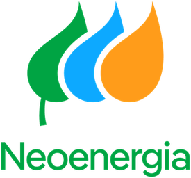

<p align="center">
  
</p>

# Neoenergia (Cosern / Coelba / Celpe) — Home Assistant

[](https://github.com/hudsonbrendon/ha-neoenergia/actions/workflows/tests.yml)
[](https://github.com/hudsonbrendon/ha-neoenergia/actions/workflows/hassfest.yml)
[](https://github.com/hudsonbrendon/ha-neoenergia/actions/workflows/validate.yml)
[](https://github.com/hudsonbrendon/ha-neoenergia/releases)
[](https://github.com/hudsonbrendon/ha-neoenergia/releases)
[](https://hacs.xyz/)
[](https://www.home-assistant.io/)
[](LICENSE)

Integração não-oficial que traz os dados da sua conta de energia **Neoenergia**
— incluindo a **Cosern** (Rio Grande do Norte) — para o Home Assistant: faturas,
consumo (kWh) e bandeira tarifária, por unidade consumidora (UC).

Feita por engenharia reversa da **Agência Virtual** web
(`agenciavirtual.neoenergia.com`). Detalhes em
[`REVERSE_ENGINEERING.md`](REVERSE_ENGINEERING.md).

> Projeto pessoal, sem vínculo com a Neoenergia. Use com a sua própria conta.

## ⚠️ Status: login protegido por reCAPTCHA

A Agência Virtual exige **reCAPTCHA v3** no login (`/areanaologada/2.0.0/autentica`)
e devolve um token de 1 h sem refresh. Esta integração **não contorna o captcha**,
então hoje ela não consegue logar sozinha. O código fica como referência do
mapa de API (ver `REVERSE_ENGINEERING.md`).

Caminhos legítimos para ter os dados no HA:
- **Fatura digital por e-mail** + integração IMAP do HA (valor/vencimento a
  partir do e-mail da Cosern).
- **RE do app Android** `br.com.neoenergia.app`, puxado do seu celular via ADB,
  que pode usar outro mecanismo de auth.

## Instalação (HACS)

[](https://my.home-assistant.io/redirect/hacs_repository/?owner=hudsonbrendon&repository=ha-neoenergia&category=integration)
[](https://my.home-assistant.io/redirect/config_flow_start/?domain=neoenergia)

1. HACS → repositórios customizados → `hudsonbrendon/ha-neoenergia` (Integration).
2. Instale e reinicie o Home Assistant.
3. Adicionar Integração → **Neoenergia** → informe CPF/CNPJ, senha, distribuidora
   (**cosern** para RN) (o login vai falhar por causa do reCAPTCHA, veja acima).

## Entidades (um dispositivo por UC)

- **Fatura atual** — valor; vencimento, status, referência, código de barras e
  PIX nos atributos.
- **Consumo** (kWh) — consumo mais recente + histórico nos atributos.
- **Bandeira tarifária** — cor/nome vigente (global).

Atualização a cada 6 h (cloud polling).

## Status

- ✅ Auth OAuth2 e mapa de endpoints: completos (RE do SPA).
- ⛔ Login headless: bloqueado pelo reCAPTCHA v3 (não contornado).

## Desenvolvimento

```bash
python3 -I tests/test_api.py
```

## Aviso

A API é privada e pode mudar sem aviso. A integração só faz leituras.
